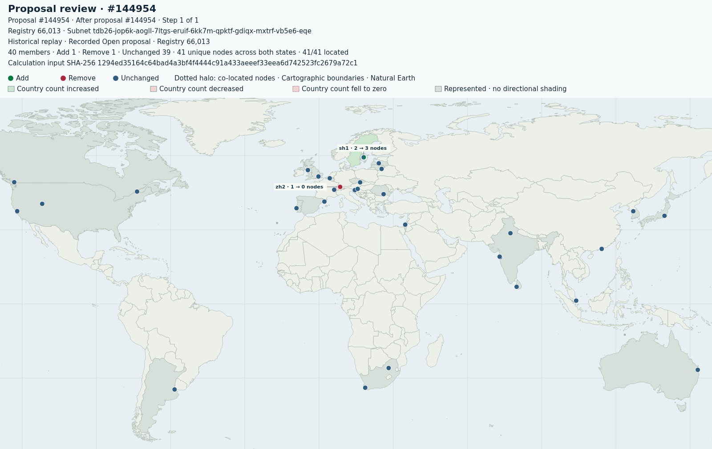

# Proposal review · #144954

Proposal #144954 · After proposal #144954 · Step 1 of 1

Subnet `tdb26-jop6k-aogll-7ltgs-eruif-6kk7m-qpktf-gdiqx-mxtrf-vb5e6-eqe`

Historical replay · Recorded Open proposal · Registry 66,013

## Summary

Replace one node at zh2 with one at sh1. The subnet remains at 40 nodes. zh2 loses its last subnet member. sh1 membership changes 2 → 3. Both changed nodes have the same registered provider.

40 members · Add 1 · Remove 1 · Unchanged 39

Target subnet checked; assignments in the other 95 listed subnets were not checked.

## Evidence scope

Pinned Registry version **66,013**. Governance checked after the selected comparisons.

- #144954 · Recorded status: Open · Original Governance observation 2026-11-25 13:08:13.589 UTC · Local replay served 2026-11-27 14:51:15.172 UTC

- Proposed membership is conditional on the pinned evidence. Full execution validity remains unverified.

Original Registry observations 2026-11-25 13:00:30.954 UTC to 2026-11-25 13:00:40.949 UTC.

Synthetic NNS-role supplement · nns\_subnet\_id set to the recorded target principal

## Map

Add (green) · Remove (red) · Unchanged (blue). 41 unique nodes across both states · 41/41 located. Positions use the registered data-center coordinates. The dotted halo indicates multiple node identities at the same coordinates.

Country count increased · Country count decreased · Country count fell to zero · Represented · no directional shading. Dashed border marks a country falling to zero. Natural Earth map-unit boundaries are cartographic. Country shading uses recorded membership groups.

Changed sites · sh1 · 2 → 3 nodes · zh2 · 1 → 0 nodes

## Node changes

| Action | Node | Data center | Registered owner | Provider | Operator | Country |
| --- | --- | --- | --- | --- | --- | --- |
| Remove | tg4ec-b2g4p-h42kd-k7zvb-6rls2-i2q7l-gtr4h-ymr6v-rrez4-w6fao-oqe | zh2 | Everyware | bvcsg-3od6r-jnydw-eysln-aql7w-td5zn-ay5m6-sibd2-jzojt-anwag-mqe | s7dud-dfedw-dmrax-rjvop-5k4qw-htm4w-gj7ak-j2itz-txwwn-o5ymv-tae | 🇨🇭 Switzerland (CH) |
| Add | kaoz3-4okcl-24amq-v5y4k-vim56-4njvo-fwvyk-v4grq-kuqum-7zm3p-4qe | sh1 | Digital Realty | bvcsg-3od6r-jnydw-eysln-aql7w-td5zn-ay5m6-sibd2-jzojt-anwag-mqe | lgp6d-brhlv-35izu-khc6p-rfszo-zdwng-xbtkh-xyvjg-y3due-7ha7t-uae | 🇸🇪 Sweden (SE) |

## Decentralisation

Arrows show before → proposed; a single value is unchanged.

### Different groups represented

How many different registered groups have at least one member in this subnet?

| Continent | Country | Data center | Registered owner | Provider | Operator |
| --- | --- | --- | --- | --- | --- |
| 6 | 24 | 39 → 38 | 39 → 38 | 38 | 39 → 38 |

### Largest group size

The most subnet nodes sharing one value, such as one provider or one country label. Several groups may tie.

| Continent | Country | Data center | Registered owner | Provider | Operator |
| --- | --- | --- | --- | --- | --- |
| 17 | 3 | 2 → 3 | 2 → 3 | 3 | 2 → 3 |

### Nakamoto coefficients

How many of the largest registered groups together contain more than one-third of the subnet's nodes? Each state uses floor(N / 3) + 1. Recorded groups do not establish independent ownership, subnet safety, execution validity or Target Topology compliance.

Node threshold: 14.

| Continent | Country | Data center | Registered owner | Provider | Operator |
| --- | --- | --- | --- | --- | --- |
| 1 | 5 | 13 → 12 | 13 → 12 | 12 | 13 → 12 |

### Distances between registered node locations

Straight-line geographic distances calculated from registered data-center coordinates, counting each pair of nodes once. These are not measured network latency or health.

| Shortest | Average | Longest |
| --- | --- | --- |
| 0 km | 7,367.0 km → 7,361.8 km | 19,461.4 km |

780 of 780 pairs before and proposed.

No current Target Topology thresholds, exceptions or applicability are assumed.

Recorded country membership

| Country (recorded token) | Subnet members |
| --- | --- |
| 🇦🇷 Argentina (AR) | 1 |
| 🇦🇺 Australia (AU) | 1 |
| 🇧🇪 Belgium (BE) | 1 |
| 🇨🇦 Canada (CA) | 2 |
| 🇨🇭 Switzerland (CH) | 3 → 2 |
| 🇨🇿 Czechia (CZ) | 1 |
| 🇪🇸 Spain (ES) | 1 |
| 🇭🇰 Hong Kong (HK) | 3 |
| 🇮🇱 Israel (IL) | 1 |
| 🇮🇲 Isle of Man (IM) | 2 |
| 🇮🇳 India (IN) | 3 |
| 🇯🇵 Japan (JP) | 1 |
| 🇰🇷 South Korea (KR) | 3 |
| 🇱🇰 Sri Lanka (LK) | 1 |
| 🇱🇹 Lithuania (LT) | 1 |
| 🇱🇻 Latvia (LV) | 1 |
| 🇵🇹 Portugal (PT) | 1 |
| 🇷🇴 Romania (RO) | 1 |
| 🇸🇪 Sweden (SE) | 2 → 3 |
| 🇸🇬 Singapore (SG) | 1 |
| 🇸🇮 Slovenia (SI) | 2 |
| 🇬🇧 United Kingdom (UK) | 1 |
| 🇺🇸 United States (US) | 3 |
| 🇿🇦 South Africa (ZA) | 3 |

## Unchanged nodes

Unchanged nodes (39)

| Node | Data center | Registered owner | Provider | Operator | Country |
| --- | --- | --- | --- | --- | --- |
| nuass-yihti-wszdr-r7qze-32dgz-osovf-pracd-hg5tt-mwlhf-rvuyq-4ae | jb2 | Africa Data Centres | nmdd6-rouxw-55leh-wcbkn-kejit-njvje-p4s6e-v64d3-nlbjb-vipul-mae | 3bohy-zygmq-6novb-wm65r-3k3y2-deh42-7emld-zhqo7-xl2oa-iextm-fae | 🇿🇦 South Africa (ZA) |
| ncr4b-rasb7-tueb3-n4uos-5nxou-3wbxv-xmyt3-wfdsd-vu4b6-5x3cp-aqe | ld1 | Latitude.sh | i3cfo-s2tgu-qe5ym-wk7e6-y7ura-pptgu-kevuf-2feh7-z4enq-5hz4s-mqe | raiov-7se2a-qvvut-fosrr-ewckg-wwvx5-yiyih-msga4-kibn2-tel4j-uae | 🇬🇧 United Kingdom (UK) |
| jyh32-azcnn-mwosu-urewl-m3pyx-6pmlq-lu5fu-vqjyl-gwx3j-zqrjr-gae | bu1 | M247 | i7dto-bgkj2-xo5dx-cyrb7-zkk5y-q46eh-gz6iq-qkgyc-w4qte-scgtb-6ae | c5ssg-eh22p-pmsn6-fpjzj-k5nql-mx5mc-7gb4a-4klco-c4f37-ydnfp-bae | 🇷🇴 Romania (RO) |
| yahq2-6rnmm-n7ubm-q76zd-256dl-5f7k6-jxx5l-njyo2-hl7tk-sqcet-6ae | ar1 | SyT - Servicios y Telecomunicaciones S.A. | s5nvr-ipdxf-xg6wd-ofacm-7tl4i-nwjzx-uulum-cugwb-kbpsa-wrsgs-cae | 5p6xp-glfoz-fgh6d-4rx7e-hix7t-c4vcp-u2xhn-gv4mm-fkozw-6mntb-7qe | 🇦🇷 Argentina (AR) |
| himck-kjpb3-eih7e-knfcr-tkz7f-qzx45-i6xwm-obvn7-fw2hv-2zuy7-aqe | ge1 | HighDC | 7ryes-jnj73-bsyu4-lo6h7-lbxk5-x4ien-lylws-5qwzl-hxd5f-xjh3w-mqe | yngfj-akg4s-nectt-whzgk-5zqbw-z3e5u-zuycn-zqygi-xz4vt-244v6-zae | 🇨🇭 Switzerland (CH) |
| gj6gc-mbslq-bt63y-72b7h-xs2xw-6vyuj-frvp3-tx375-dsqx5-wem6o-vqe | lj2 | Anonstake | kos24-5xact-6aror-uofg2-tnvt6-dq3bk-c2c5z-jtptt-jbqvc-lmegy-qae | eu5wc-g7r7l-zzy2o-227af-hfvin-orflw-4vdlf-j7gks-n5wrj-zezt7-tqe | 🇸🇮 Slovenia (SI) |
| jmuoq-7kbey-cbtmm-zlz6t-chwt6-dk7ly-d3jim-5nuu4-y5tou-l5egg-7qe | bc1 | Cyxtera | 7at4h-nhtvt-a4s55-jigss-wr2ha-ysxkn-e6w7x-7ggnm-qd3d5-ry66r-cae | feb2q-mgxwe-okz7r-juws2-mahg4-wflqu-oeflf-kvh4r-qaqit-hbqpg-uqe | 🇨🇦 Canada (CA) |
| nf7qq-vkm72-lttne-dsnke-3x73z-ofybh-ogahy-vyvta-dgbny-s5dr7-qqe | sj3 | InfoObjects | 7ws2n-wqorv-vmo4m-5e222-n42c3-hk43s-ei3kp-4hpbn-xlkzo-jgv7i-tqe | jtrpk-wokqg-aqmcn-esiq7-fip4e-dl7lv-iwdyj-cu5pm-wbg7i-4jl4t-wae | 🇺🇸 United States (US) |
| 5iihd-fkroy-ow5zp-hlvwz-bsgbl-mecta-kxubm-6adxr-ckcu6-prsus-fqe | hk4 | hkntt | cgmhq-c4zja-yov4u-zeyao-64ua5-idlhb-ezcgr-cultv-3vqjs-dhwo7-rqe | aaxec-cijpz-vzdwe-546fi-vahtf-s2awa-ldn7q-mzl2j-gmvhz-56zlq-mqe | 🇭🇰 Hong Kong (HK) |
| sekkk-e24lo-s2zu3-5ltyu-kbzqs-44bpv-klm7l-72g2n-z7zxu-2pqpu-pae | hk3 | hkcolo | 4fedi-eu6ue-nd7ts-vnof5-hzg66-hgzl7-liy5n-3otyp-h7ipw-owycg-uae | 4lbqo-vgpoe-kemak-voout-777uo-kk74n-fnct3-pc4eg-3txi3-7cghf-rqe | 🇭🇰 Hong Kong (HK) |
| gvm7l-ds4n6-vkyjn-gwalp-3vdo6-qfmq7-pxhu4-zvqcu-ozvb7-qz3gr-vqe | tv1 | Interhost | 6sq7t-knkul-fko6h-xzvnf-ktbvr-jhx7r-hapzr-kjlek-whugy-zt6ip-xqe | lis4o-siuek-6zrm6-g5pkh-lswnt-ttsd4-henvb-d6mit-lgfpr-lynph-xae | 🇮🇱 Israel (IL) |
| k2ovz-ptdmz-hzmkh-ntfqn-evhux-ktxz4-26jg6-qjjsa-rpgal-wkdjo-kqe | rg3 | Nano | diyay-s4rfq-xnx23-zczwi-nptra-5254n-e4zn6-p7tqe-vqhzr-sd4gd-bqe | bftbl-quva3-hsn2r-qsjde-goegh-rupku-gb7xx-utj6e-lswl4-hclva-bqe | 🇱🇻 Latvia (LV) |
| ulhxy-qlokv-5iual-yizlo-dtlmi-aavz5-bi7ez-kjwqz-la64z-cxjuk-fae | br2 | AtlasEdge | rbn2y-6vfsb-gv35j-4cyvy-pzbdu-e5aum-jzjg6-5b4n5-vuguf-ycubq-zae | oorkg-ilned-36bwb-vyprm-56g55-hp6xq-gucq3-fmn2i-44a4e-txzlp-gqe | 🇧🇪 Belgium (BE) |
| lxgqb-dlqzi-schn4-i2mha-qh6re-eq3c2-3k6cn-oqumg-jkmgk-d4gex-3qe | cm1 | OrionStellar | eybf4-6t6bb-unfb2-h2hhn-rrfi2-cd2vs-phksn-jdmbn-i463m-4lzds-vqe | ywjtr-pq5wc-m6foq-tyxvk-2a3wc-dlg3k-aaebf-6rk2d-5yvn7-tf743-gqe | 🇱🇰 Sri Lanka (LK) |
| 4mfcc-d3te7-zk2in-n5hm2-tcquv-bgc2e-obpbh-xp5jc-7boqr-oidte-jqe | hk1 | Unicom | g2ax6-jrkmb-3zuh3-jibtb-q5xoq-njrgo-5utbc-j2o7g-zfq2w-yyhky-dqe | z6cfb-dbya3-nh4pm-nyteq-76n7d-xzi27-tf3cg-t7sz7-244qt-6rnjy-3ae | 🇭🇰 Hong Kong (HK) |
| w2sev-mtuls-aa7m5-cdjgi-5vipg-2jn7i-4awvf-o6suu-73ebs-sw5db-kqe | pl2 | Yotta | zy4m7-z5mhs-zfkpl-zlsjl-blrbx-mvvmq-5z4zu-mf7eq-hhv7o-ezfro-3ae | 7rw6b-6r7qv-al3uk-rimg7-ifkjv-hettz-lhmly-t55g7-xrwac-25ayy-wae | 🇮🇳 India (IN) |
| vysyd-tlwq5-f5vfi-kw2jc-ziylz-di2s5-sf4p3-iflm7-vyvjv-hz3b3-pae | kr2 | Gasan | 64xe5-tx2s3-4gjmj-pnozr-fejw2-77y5y-rhcjk-glnmx-62brf-qin5q-pqe | 5dwhe-vpbuf-zz5ml-ylu6k-7y2z2-36ywv-5e4wf-advxd-3endk-icvg4-cae | 🇰🇷 South Korea (KR) |
| zatyv-4l26n-3lecc-xpeme-ul34o-yiye2-3d447-aiiz4-5pxtm-v44nh-cqe | mb1 | Posita.si | wdjjk-blh44-lxm74-ojj43-rvgf4-j5rie-nm6xs-xvnuv-j3ptn-25t4v-6ae | 3xiew-2wo3x-tnbn2-o7kok-wwsnw-7koo2-gna5r-rlrt3-zotsh-dwpg6-kae | 🇸🇮 Slovenia (SI) |
| isegs-i4akf-kb7st-hnqjn-4col7-qxpph-pncbs-25hiy-5pwsu-nyw3x-xae | kr1 | KT | r3yjn-kthmg-pfgmb-2fngg-5c7d7-t6kqg-wi37r-j7gy6-iee64-kjdja-jae | iubpe-vrzpt-cdf5f-kkzhq-rgp63-dkbfo-fje7f-6aknf-jekzg-3s7tv-oae | 🇰🇷 South Korea (KR) |
| 6hvx2-ymemx-tmykh-vxyic-bgfhv-2lcmt-3oy4x-rysuf-rnerz-vqokw-sqe | nm1 | Rivram | ulyfm-vkxtj-o42dg-e4nam-l4tzf-37wci-ggntw-4ma7y-d267g-ywxi6-iae | mpmyf-juliu-5qwcu-ofamg-es7ug-4mjt4-w5lht-dbrfb-ualjm-hcwmn-pae | 🇮🇳 India (IN) |
| 5mpdi-v4qj2-64are-tbe6r-6335g-6tksh-c7uzq-w3xyz-o4p5g-rwnll-vqe | ty3 | Equinix | sixix-2nyqd-t2k2v-vlsyz-dssko-ls4hl-hyij4-y7mdp-ja6cj-nsmpf-yae | a5glg-n6ul6-rkuc7-idthk-fb2fe-d5m75-4g4l7-22yko-h27pr-q3a7k-lae | 🇯🇵 Japan (JP) |
| v6r7h-luxm5-nxusv-bvhek-sis7i-sitrx-ezprf-j2lp3-2tnlt-2m6yt-zae | dr1 | FiberState | trxbq-wy5xi-3y27q-bkpaf-mhi2m-puexs-yatgt-nhwiy-dh6jy-rolw5-zqe | nhr3z-ekrj4-7usls-kmdbv-esy2j-3wvez-ck46k-qpdn6-i23c2-5xkgr-dae | 🇺🇸 United States (US) |
| 2nehn-z42p7-36s7j-qqcz6-sy5rb-euhte-necpl-egqsv-hdoph-gx7qd-6ae | im1 | Manx Telecom | rpfvr-s3kuw-xdqrr-pvuuj-hc7hl-olytw-yxlie-fmr74-sr572-6gdqx-iqe | 4isre-d3zxy-xpque-tagdf-xdzjp-hk7x3-szquu-kuwej-52cfy-f6jwc-zqe | 🇮🇲 Isle of Man (IM) |
| 3zfpk-du6xx-yg7j5-h7c5w-6rr7z-cmkbf-pfos7-lhu65-svdmj-co7nc-cae | sg3 | Racks Central | x7uok-pi537-itm37-unjn3-ewkze-kuetg-kptap-nuqak-auq7z-tn5ey-dqe | vicvb-nkzkt-tj2lz-yzzw4-gfcsj-3eggv-izdti-tarpt-fsojm-lgq22-wae | 🇸🇬 Singapore (SG) |
| 2ftux-ivgjc-t4i2d-lq5hs-myjdg-3h2pz-l2ddl-nsxfc-wlaq7-fkbc5-6ae | sl1 | Megazone Cloud | 4dibr-2alzr-h6kva-bvwn2-yqgsl-o577t-od46o-v275p-a2zov-tcw4f-eae | ukji3-ju5bx-ty5r7-qwk4p-eobil-isp26-fsomg-44kwf-j4ew7-ozkqy-wqe | 🇰🇷 South Korea (KR) |
| nj7re-dvkal-yq25a-opp2g-5y3qy-3ena4-opd5j-22uir-eaakx-ljk7k-6ae | nd1 | Marvelous Web3 DC | pa5mu-yxsey-b4yrk-bodka-dhjnm-a3nx4-w2grw-3b766-ddr6e-nupu4-pqe | ihcmc-o45dd-elg2s-ntnhr-l4c35-datk6-gsyeb-m77as-yjzd2-4qyxz-xqe | 🇮🇳 India (IN) |
| tbzjp-lv2kb-xhel7-36r77-rfa3z-6iox2-c4ttr-cppwv-naxob-n3arn-fae | im2 | Continent8 | glrjs-2dbzh-owbdd-fpp5e-eweoz-nsuto-e3jmk-tl42c-wem4f-qfpfa-qqe | ylbc3-d72nf-cv76h-era7m-zefob-r5kyw-kvdtp-xq4ep-nthfy-ml5ua-iae | 🇮🇲 Isle of Man (IM) |
| 5veru-kf3gn-vjdxg-drid6-qpl2s-ojbxd-i73zf-kded7-7e4q3-5vuni-3qe | es1 | Adam | w4buy-lgwzr-pccs7-huzhh-qqnws-rns75-iaoox-jolrm-xs2ra-vdu3o-2qe | 6zkgt-w7agd-kpvte-mia3x-sxucz-u2r7k-vfphb-tyhvv-i6hsm-h2ueo-uqe | 🇪🇸 Spain (ES) |
| dw2ac-qodm4-snxe5-bnat5-2nu2z-mmogu-7gps7-z4gon-zadqs-3dbqh-pae | fm1 | Hurricane Electric | hk7eo-22zam-kqmsx-dtfbj-k5i6f-jg65h-micpf-2cztc-t2eqk-efgvx-vqe | hoqyg-qkf6b-ulmyi-zfk6z-fuvlo-pekr6-goigz-qweij-xhghd-vibjl-jqe | 🇺🇸 United States (US) |
| mae7q-ggnbj-xb52f-hvest-dgqoc-whvsq-yui5d-5cys2-zeold-l5ydx-oae | bn1 | Master Internet | efem5-kmwaw-xose7-zzhgg-6bfif-twmcw-csg7a-lmqvn-wrdou-mjwlb-vqe | zc635-ppr46-ap6eg-pghtn-wtnxz-6czvv-a4uxm-adjgb-wtoh4-2ddnl-uae | 🇨🇿 Czechia (CZ) |
| 24fcm-3onfs-cykax-al4jb-gvdd3-u76zl-ht6ef-hcsbc-xwf54-xbrym-xae | bt1 | Baltneta | 4jjya-hlyyc-s766p-fd6gr-d6tvv-vo3ah-j5ptx-i73gw-mwgyd-rw6w2-rae | mbnsu-w4xfc-pmdok-r2lwo-wxfr4-gigu5-4idcm-5uuuy-znvby-biiny-jqe | 🇱🇹 Lithuania (LT) |
| u4zo2-i6nsc-mowwj-lf6az-s6rdo-caskt-a6yx6-fke5w-qyezs-lyqvn-tqe | sc1 | NEXTDC | unqqg-no4b2-vbyad-ytik2-t3vly-3e57q-aje2t-sjb5l-bd4ke-chggn-uqe | f3toa-2qbnz-67mnl-ws76t-asi36-oz7vd-w5xjx-u5n75-jchls-uhioe-6qe | 🇦🇺 Australia (AU) |
| anudy-m6vfi-lphxb-sazpy-la4ti-2hriw-c67ny-butfn-axcel-otvuh-oqe | mtl1 | Leaseweb | 7uioy-xitfw-yqcko-5gpya-3lpsw-dw7zt-dyyyf-wfqif-jvi76-fdbkg-cqe | ueggl-7wvx2-2eezj-mgjrg-w6tmy-ngmye-xxbwu-gumli-hdf7u-zzpng-3ae | 🇨🇦 Canada (CA) |
| lh2af-66zso-76kqu-d57ag-jca5d-yvmfo-rcabh-ptlvj-ltfdf-kyg6q-lqe | li2 | Edgoo Networks | mjnyf-lzqq6-s7fzb-62rqm-xzvge-5oa26-humwp-dvwxp-jxxkf-hoel7-fqe | nvocp-jlbys-d44wi-od3pv-iws4n-2nll3-73hqk-koh72-3obvg-kt5v3-fae | 🇵🇹 Portugal (PT) |
| urnku-x7qn7-gt2mu-kueib-duqoz-xcdgj-hsnwl-5q32r-w3vqp-on6lq-gae | ct2 | Teraco | py2kr-ipr2p-ryh66-x3a3v-5ts6u-7rfhf-alkna-ueffh-hz5ox-lt6du-qqe | x7fjr-ngws7-jpjtq-e3c7s-735uk-gyusv-ppoeh-n4xhg-fwjck-um6pf-fae | 🇿🇦 South Africa (ZA) |
| 5gcqu-upr5b-ol3fj-vz273-3ov5j-s2dzp-d3n4o-c3rdz-rnhto-tovcx-zqe | sh1 | Digital Realty | bvcsg-3od6r-jnydw-eysln-aql7w-td5zn-ay5m6-sibd2-jzojt-anwag-mqe | lgp6d-brhlv-35izu-khc6p-rfszo-zdwng-xbtkh-xyvjg-y3due-7ha7t-uae | 🇸🇪 Sweden (SE) |
| oxevh-yptgl-yzu2p-w6dyn-lr6jc-b2xaq-aatz2-yyfot-hm4pr-ucvh6-gae | zh5 | Green.ch | hzqcb-iiagd-4erjo-qn7rq-syqro-zztl6-cpble-atnkd-2c6bg-bxjoa-qae | ap2qh-n5jrf-vpjj6-i5pap-qxnhr-4tnar-yodpw-kh6fy-c5w4z-gibij-5ae | 🇨🇭 Switzerland (CH) |
| q4ksz-lpvfy-ikkem-wyuaa-abopq-nmu5k-ovh6h-xfoqk-hx3x3-g2bk6-4qe | jb3 | Xneelo | mme7u-zxs3z-jq3un-fbaly-nllcz-toct2-l2kp3-larrb-gti4r-u2bmo-dae | ymenq-4sr5h-3imm6-kjjw6-2knuy-ntmlu-oqf5k-vdnzv-z427q-gqdot-sae | 🇿🇦 South Africa (ZA) |
| uafcv-c76tx-jzddu-wxygw-4yzkm-nyr7u-iwk57-bwind-wmupb-2wos6-4qe | sh1 | Digital Realty | bvcsg-3od6r-jnydw-eysln-aql7w-td5zn-ay5m6-sibd2-jzojt-anwag-mqe | lgp6d-brhlv-35izu-khc6p-rfszo-zdwng-xbtkh-xyvjg-y3due-7ha7t-uae | 🇸🇪 Sweden (SE) |

## Sources and calculation

Membership preview revision `927e286ecc136b3052d32d9382b6bb93a0c1cd0775e76e4bd099a18dd4842476`.

Calculation input SHA-256 `1294ed35164c64bad4a3bf4f4444c91a433aeeef33eea6d742523fc2679a72c1` · analysis v5.

The replicated calculation digest identifies the exact submitted evidence and scope. Source receipts identify the separate Registry and Governance observations.

- #144954 executable payload SHA-256 f2875737ce603f9f03b65366f23abd880fdba50e42e7f685ee2dbfb3815db37b

Exact distance evidence in metres

| Distance | Before | Proposed |
| --- | --- | --- |
| Shortest | 0 | 0 |
| Average | 7367029 | 7361847 |
| Longest | 19461421 | 19461421 |

Registered geography evidence

| Data center | Original Registry region | Country token |
| --- | --- | --- |
| zh2 | Europe,CH,Zurich | CH |
| sh1 | Europe,SE,Stockholm | SE |
| jb2 | Africa,ZA,Gauteng | ZA |
| ld1 | Europe,UK,London | UK |
| bu1 | Europe,RO,Bucuresti | RO |
| ar1 | South America,AR,CABA | AR |
| ge1 | Europe,CH,Geneva | CH |
| lj2 | Europe,SI,Ljubljana | SI |
| bc1 | North America,CA,British Columbia | CA |
| sj3 | North America,US,California | US |
| hk4 | Asia,HK,HongKong | HK |
| hk3 | Asia,HK,HongKong | HK |
| tv1 | Asia,IL,Tel Aviv | IL |
| rg3 | Europe,LV,Riga | LV |
| br2 | Europe,BE,Brussels Capital | BE |
| cm1 | Asia,LK,Colombo | LK |
| hk1 | Asia,HK,HongKong | HK |
| pl2 | Asia,IN,Panvel | IN |
| kr2 | Asia,KR,Seoul | KR |
| mb1 | Europe,SI,Maribor | SI |
| kr1 | Asia,KR,Seoul | KR |
| nm1 | Asia,IN,Navi Mumbai | IN |
| ty3 | Asia,JP,Tokyo | JP |
| dr1 | North America,US,Utah | US |
| im1 | Europe,IM,Douglas | IM |
| sg3 | Asia,SG,Singapore | SG |
| sl1 | Asia,KR,Seoul | KR |
| nd1 | Asia,IN,New Delhi | IN |
| im2 | Europe,IM,Douglas | IM |
| es1 | Europe,ES,Barcelona | ES |
| fm1 | North America,US,California | US |
| bn1 | Europe,CZ,South Moravian Region | CZ |
| bt1 | Europe,LT,Vilnius | LT |
| sc1 | Oceania,AU,Queensland | AU |
| mtl1 | North America,CA,Quebec | CA |
| li2 | Europe,PT,Lisbon | PT |
| ct2 | Africa,ZA,Cape Town | ZA |
| zh5 | Europe,CH,Zurich | CH |
| jb3 | Africa,ZA,Gauteng | ZA |

Session source receipts (130)

| Method | Item | Canister | Replay delivery time | Reply SHA-256 or issue |
| --- | --- | --- | --- | --- |
| get\_proposal\_info | 144954 | uxrrr-q7777-77774-qaaaq-cai | 2026-11-27 14:51:06.183 UTC | 92cc11a832f1c5c044ac4d0f11f81694e8598dce73824656b670f6a28503b07f |
| get\_latest\_version | Registry head | uxrrr-q7777-77774-qaaaq-cai | 2026-11-27 14:51:06.183 UTC | 636fda49c6d3d56e23e8a2589939db06fa9d9a86b8a1b8420a7df4087f8167fa |
| get\_value | subnet\_list | uxrrr-q7777-77774-qaaaq-cai | 2026-11-27 14:51:06.183 UTC | b1912c26f82f37f4cd16a8dbccedfdbccc18d12669c6a8a89da8f54f59574e21 |
| get\_value | subnet\_record\_tdb26-jop6k-aogll-7ltgs-eruif-6kk7m-qpktf-gdiqx-mxtrf-vb5e6-eqe | uxrrr-q7777-77774-qaaaq-cai | 2026-11-27 14:51:06.183 UTC | 6497dae72639a74c9dd115f782052f1b6a6029eb34c0648789046b7fc0c4ab78 |
| get\_value | node\_record\_tg4ec-b2g4p-h42kd-k7zvb-6rls2-i2q7l-gtr4h-ymr6v-rrez4-w6fao-oqe | uxrrr-q7777-77774-qaaaq-cai | 2026-11-27 14:51:06.183 UTC | b8445d695505738896abbbb7f3544ac1a6273dfc77e5eddae2fc8c9350f8619c |
| get\_value | node\_record\_kaoz3-4okcl-24amq-v5y4k-vim56-4njvo-fwvyk-v4grq-kuqum-7zm3p-4qe | uxrrr-q7777-77774-qaaaq-cai | 2026-11-27 14:51:06.183 UTC | cebac6b382243c305722ff194f6b6978d4601f69ee7bd85d236b7ff4644a4d0a |
| get\_value | api\_boundary\_node\_tg4ec-b2g4p-h42kd-k7zvb-6rls2-i2q7l-gtr4h-ymr6v-rrez4-w6fao-oqe | uxrrr-q7777-77774-qaaaq-cai | 2026-11-27 14:51:06.183 UTC | c279ba1472cf7394ef3bbe7bf0b0b7454aa4b09f3e805e83fc390d975243912d |
| get\_value | api\_boundary\_node\_kaoz3-4okcl-24amq-v5y4k-vim56-4njvo-fwvyk-v4grq-kuqum-7zm3p-4qe | uxrrr-q7777-77774-qaaaq-cai | 2026-11-27 14:51:06.183 UTC | 2cd7fe663030d5026cd4920952afc464df190c9d2cb140ab37cfa8391f2328d3 |
| get\_proposal\_info | 144954 | uxrrr-q7777-77774-qaaaq-cai | 2026-11-27 14:51:06.183 UTC | 92cc11a832f1c5c044ac4d0f11f81694e8598dce73824656b670f6a28503b07f |
| get\_value | node\_record\_dw2ac-qodm4-snxe5-bnat5-2nu2z-mmogu-7gps7-z4gon-zadqs-3dbqh-pae | uxrrr-q7777-77774-qaaaq-cai | 2026-11-27 14:51:09.793 UTC | b2ed6444f420c18b1b374eceb243ffd426dc1d152afad7c193b21e20b32b9598 |
| get\_value | node\_record\_himck-kjpb3-eih7e-knfcr-tkz7f-qzx45-i6xwm-obvn7-fw2hv-2zuy7-aqe | uxrrr-q7777-77774-qaaaq-cai | 2026-11-27 14:51:09.793 UTC | 4a5354a55a96d2aa22ff6fbab737bc40fee212e342cc5aaa4aa6bdbffd2acf29 |
| get\_value | node\_record\_tbzjp-lv2kb-xhel7-36r77-rfa3z-6iox2-c4ttr-cppwv-naxob-n3arn-fae | uxrrr-q7777-77774-qaaaq-cai | 2026-11-27 14:51:09.793 UTC | 3f6862babab9c9758c7cde143669b9f8c6e0e1667b101900af1c50252e202b76 |
| get\_value | node\_record\_nf7qq-vkm72-lttne-dsnke-3x73z-ofybh-ogahy-vyvta-dgbny-s5dr7-qqe | uxrrr-q7777-77774-qaaaq-cai | 2026-11-27 14:51:09.793 UTC | a3223869f5113a5b02223c380955ff7da51c83aaaa82cb43a13e64fb1fd60bb1 |
| get\_value | node\_record\_oxevh-yptgl-yzu2p-w6dyn-lr6jc-b2xaq-aatz2-yyfot-hm4pr-ucvh6-gae | uxrrr-q7777-77774-qaaaq-cai | 2026-11-27 14:51:09.793 UTC | 9e606e701558695a0d0c72b2729df9aa81ec7eab3aa57b9cae668d5eddf7dcb2 |
| get\_value | node\_record\_v6r7h-luxm5-nxusv-bvhek-sis7i-sitrx-ezprf-j2lp3-2tnlt-2m6yt-zae | uxrrr-q7777-77774-qaaaq-cai | 2026-11-27 14:51:09.793 UTC | 02ef89ca2163b00bdafbf0eb516a4bcb88210707d475a376064180245e20e68f |
| get\_value | node\_record\_urnku-x7qn7-gt2mu-kueib-duqoz-xcdgj-hsnwl-5q32r-w3vqp-on6lq-gae | uxrrr-q7777-77774-qaaaq-cai | 2026-11-27 14:51:09.793 UTC | 3f885f8b984e1ab88631aac58bcee88a67a2442b923c9f9ed8a669aee00084d7 |
| get\_value | node\_record\_sekkk-e24lo-s2zu3-5ltyu-kbzqs-44bpv-klm7l-72g2n-z7zxu-2pqpu-pae | uxrrr-q7777-77774-qaaaq-cai | 2026-11-27 14:51:09.793 UTC | db6f23b78638161f3602d2ea52104e98b6c256f589224e01cbe7a4ce37d6ce38 |
| get\_value | node\_record\_4mfcc-d3te7-zk2in-n5hm2-tcquv-bgc2e-obpbh-xp5jc-7boqr-oidte-jqe | uxrrr-q7777-77774-qaaaq-cai | 2026-11-27 14:51:09.793 UTC | 7805f87ed8a5c9111cf34882b1883b2e56eff3a0fd6b5db76db2c9f1948de2f5 |
| get\_value | node\_record\_nj7re-dvkal-yq25a-opp2g-5y3qy-3ena4-opd5j-22uir-eaakx-ljk7k-6ae | uxrrr-q7777-77774-qaaaq-cai | 2026-11-27 14:51:09.793 UTC | 0a76d24f32e605f86b1e3e079087e0b20256d0f091af598f91102726b858d91c |
| get\_value | node\_record\_5veru-kf3gn-vjdxg-drid6-qpl2s-ojbxd-i73zf-kded7-7e4q3-5vuni-3qe | uxrrr-q7777-77774-qaaaq-cai | 2026-11-27 14:51:09.793 UTC | 7fc32d8c472532ee6292bfe30eca77b2361fb2f284b43ede7806994e3ff2e25c |
| get\_value | node\_record\_nuass-yihti-wszdr-r7qze-32dgz-osovf-pracd-hg5tt-mwlhf-rvuyq-4ae | uxrrr-q7777-77774-qaaaq-cai | 2026-11-27 14:51:09.793 UTC | 7148b1b7d92a60a9028bea9cd78b6ffae868606dc8782f56eabee843439e2044 |
| get\_value | node\_record\_uafcv-c76tx-jzddu-wxygw-4yzkm-nyr7u-iwk57-bwind-wmupb-2wos6-4qe | uxrrr-q7777-77774-qaaaq-cai | 2026-11-27 14:51:09.793 UTC | ae18085ac8a0842c869a7268e0ba751a8b228094d33366291f72699428ff0a84 |
| get\_value | node\_record\_3zfpk-du6xx-yg7j5-h7c5w-6rr7z-cmkbf-pfos7-lhu65-svdmj-co7nc-cae | uxrrr-q7777-77774-qaaaq-cai | 2026-11-27 14:51:09.793 UTC | 44ed81f18a86c81dcdb7f24faa39daa4ad8e6269a9e66c73dc0b7de8789c9224 |
| get\_value | node\_record\_2nehn-z42p7-36s7j-qqcz6-sy5rb-euhte-necpl-egqsv-hdoph-gx7qd-6ae | uxrrr-q7777-77774-qaaaq-cai | 2026-11-27 14:51:09.793 UTC | a0c46407f5c7dab32b1d5990741c1918bd7d370aef9a98df3269968cf1006a8b |
| get\_value | node\_record\_ulhxy-qlokv-5iual-yizlo-dtlmi-aavz5-bi7ez-kjwqz-la64z-cxjuk-fae | uxrrr-q7777-77774-qaaaq-cai | 2026-11-27 14:51:09.793 UTC | 6ba6c8fd1e6c37e3e2836f9b8f5fcb643bc23160ea86a54379f11d4be10b3b02 |
| get\_value | node\_record\_vysyd-tlwq5-f5vfi-kw2jc-ziylz-di2s5-sf4p3-iflm7-vyvjv-hz3b3-pae | uxrrr-q7777-77774-qaaaq-cai | 2026-11-27 14:51:09.793 UTC | c82d8ac4a711a23263aef2a7b3a80c2734de9394fd18951323ee36527938a892 |
| get\_value | node\_record\_zatyv-4l26n-3lecc-xpeme-ul34o-yiye2-3d447-aiiz4-5pxtm-v44nh-cqe | uxrrr-q7777-77774-qaaaq-cai | 2026-11-27 14:51:09.793 UTC | 68410a1fa5f9a82b430fba33993f9b3873fa7d439a35c481f9d3b4f052d788a1 |
| get\_value | node\_record\_lh2af-66zso-76kqu-d57ag-jca5d-yvmfo-rcabh-ptlvj-ltfdf-kyg6q-lqe | uxrrr-q7777-77774-qaaaq-cai | 2026-11-27 14:51:09.793 UTC | 39c2495f0ba24a5959c325bdcfd34163c1a10cf45e37f21ee67fef18fb855dad |
| get\_value | node\_record\_5gcqu-upr5b-ol3fj-vz273-3ov5j-s2dzp-d3n4o-c3rdz-rnhto-tovcx-zqe | uxrrr-q7777-77774-qaaaq-cai | 2026-11-27 14:51:09.793 UTC | 0ef159818c57b363efb9dad357eab45899787175d09b8778bacc5d0823c4613f |
| get\_value | node\_record\_lxgqb-dlqzi-schn4-i2mha-qh6re-eq3c2-3k6cn-oqumg-jkmgk-d4gex-3qe | uxrrr-q7777-77774-qaaaq-cai | 2026-11-27 14:51:09.793 UTC | ea0c4047598314003fd03a361948af278190f38a0b99cf41e90abcd9648b10b7 |
| get\_value | node\_record\_jyh32-azcnn-mwosu-urewl-m3pyx-6pmlq-lu5fu-vqjyl-gwx3j-zqrjr-gae | uxrrr-q7777-77774-qaaaq-cai | 2026-11-27 14:51:09.793 UTC | bf15b9a6e34c9ca55ea06258013eb4a9c79d84c14e45da9ec0f96555dae4e2bf |
| get\_value | node\_record\_isegs-i4akf-kb7st-hnqjn-4col7-qxpph-pncbs-25hiy-5pwsu-nyw3x-xae | uxrrr-q7777-77774-qaaaq-cai | 2026-11-27 14:51:09.793 UTC | 2fc0d2725eb69de30a49d509bdf4901375e01a397d6ba781a3d6c26642d18963 |
| get\_value | node\_record\_k2ovz-ptdmz-hzmkh-ntfqn-evhux-ktxz4-26jg6-qjjsa-rpgal-wkdjo-kqe | uxrrr-q7777-77774-qaaaq-cai | 2026-11-27 14:51:09.793 UTC | 55b306bcfc9abdeec86c0036058c33f28c173dfc05b7fdfd1a1d28d982d69c24 |
| get\_value | node\_record\_ncr4b-rasb7-tueb3-n4uos-5nxou-3wbxv-xmyt3-wfdsd-vu4b6-5x3cp-aqe | uxrrr-q7777-77774-qaaaq-cai | 2026-11-27 14:51:10.425 UTC | 70c9cca5c6e03c843f57d4dd0dc062e66faca84be7e122e132b20ed04f15e15d |
| get\_value | node\_record\_yahq2-6rnmm-n7ubm-q76zd-256dl-5f7k6-jxx5l-njyo2-hl7tk-sqcet-6ae | uxrrr-q7777-77774-qaaaq-cai | 2026-11-27 14:51:10.425 UTC | 3227731ab991b283e816f97b298fa7e716559678fed2a82b0e9f69c6f6ee2c54 |
| get\_value | node\_record\_w2sev-mtuls-aa7m5-cdjgi-5vipg-2jn7i-4awvf-o6suu-73ebs-sw5db-kqe | uxrrr-q7777-77774-qaaaq-cai | 2026-11-27 14:51:10.425 UTC | 95d140eea7ac8d4d6cac715c41af4af6d8721f86397b4d448d56a19bf7d0eaeb |
| get\_value | node\_record\_gvm7l-ds4n6-vkyjn-gwalp-3vdo6-qfmq7-pxhu4-zvqcu-ozvb7-qz3gr-vqe | uxrrr-q7777-77774-qaaaq-cai | 2026-11-27 14:51:10.425 UTC | a2fcf6e45e81ca923f8eab342ab8124d8ad54582f5bcc4a3bc4cce7aa3cdae87 |
| get\_value | node\_record\_2ftux-ivgjc-t4i2d-lq5hs-myjdg-3h2pz-l2ddl-nsxfc-wlaq7-fkbc5-6ae | uxrrr-q7777-77774-qaaaq-cai | 2026-11-27 14:51:10.425 UTC | 13f7d9b1806a249ec31a7a2696b36dd8228dbfb0ae8dd5b6324858903ead06d7 |
| get\_value | node\_record\_jmuoq-7kbey-cbtmm-zlz6t-chwt6-dk7ly-d3jim-5nuu4-y5tou-l5egg-7qe | uxrrr-q7777-77774-qaaaq-cai | 2026-11-27 14:51:10.425 UTC | 4da5f76e8b130e187bb088191c38c23d36d30163312b8f8b6881a4ed1320d64b |
| get\_value | node\_record\_5iihd-fkroy-ow5zp-hlvwz-bsgbl-mecta-kxubm-6adxr-ckcu6-prsus-fqe | uxrrr-q7777-77774-qaaaq-cai | 2026-11-27 14:51:10.425 UTC | b1fc792d00e6422a5cec2f4e11b82e95f99548eb8f1465de06c98aecbf828416 |
| get\_value | node\_record\_24fcm-3onfs-cykax-al4jb-gvdd3-u76zl-ht6ef-hcsbc-xwf54-xbrym-xae | uxrrr-q7777-77774-qaaaq-cai | 2026-11-27 14:51:10.425 UTC | d803a8120f8a8fa2a2ea81078f5dce4e5f283c274f4931aab4b967c1db71f51d |
| get\_value | node\_record\_q4ksz-lpvfy-ikkem-wyuaa-abopq-nmu5k-ovh6h-xfoqk-hx3x3-g2bk6-4qe | uxrrr-q7777-77774-qaaaq-cai | 2026-11-27 14:51:10.425 UTC | 78f67ffeb348c30ddf03074bbf420fb87882ce7599ce2c38f15bf9e93e384ece |
| get\_value | node\_record\_u4zo2-i6nsc-mowwj-lf6az-s6rdo-caskt-a6yx6-fke5w-qyezs-lyqvn-tqe | uxrrr-q7777-77774-qaaaq-cai | 2026-11-27 14:51:10.425 UTC | 1b7a7799f7088d1e29ab08fe47dcca663f2f8bf8e39315b3a12b1a569763f352 |
| get\_value | node\_record\_mae7q-ggnbj-xb52f-hvest-dgqoc-whvsq-yui5d-5cys2-zeold-l5ydx-oae | uxrrr-q7777-77774-qaaaq-cai | 2026-11-27 14:51:10.425 UTC | 272965f4afdb13dc610df507fbadf66d0eb8b36d35a5c0838e38ef68f14ce06d |
| get\_value | node\_record\_6hvx2-ymemx-tmykh-vxyic-bgfhv-2lcmt-3oy4x-rysuf-rnerz-vqokw-sqe | uxrrr-q7777-77774-qaaaq-cai | 2026-11-27 14:51:10.425 UTC | daac7a5b6a04b9f0ca4a7b60eae988a4e1dd83101f1f552388048b20c48716c4 |
| get\_value | node\_record\_anudy-m6vfi-lphxb-sazpy-la4ti-2hriw-c67ny-butfn-axcel-otvuh-oqe | uxrrr-q7777-77774-qaaaq-cai | 2026-11-27 14:51:10.425 UTC | f06eac5e322a894b67a8775a0407795c8c6803ae5d741c5a00890bbef7c326dd |
| get\_value | node\_record\_tg4ec-b2g4p-h42kd-k7zvb-6rls2-i2q7l-gtr4h-ymr6v-rrez4-w6fao-oqe | uxrrr-q7777-77774-qaaaq-cai | 2026-11-27 14:51:10.425 UTC | b8445d695505738896abbbb7f3544ac1a6273dfc77e5eddae2fc8c9350f8619c |
| get\_value | node\_record\_gj6gc-mbslq-bt63y-72b7h-xs2xw-6vyuj-frvp3-tx375-dsqx5-wem6o-vqe | uxrrr-q7777-77774-qaaaq-cai | 2026-11-27 14:51:10.425 UTC | 2b8bed7cd7f2c7f78d75b9996d7f77c9c160cbece4e9e15ed4000e623efb1aa2 |
| get\_value | node\_record\_5mpdi-v4qj2-64are-tbe6r-6335g-6tksh-c7uzq-w3xyz-o4p5g-rwnll-vqe | uxrrr-q7777-77774-qaaaq-cai | 2026-11-27 14:51:10.425 UTC | de3aefd34289da838063c6a926eab9ed5c828339e2531bde56cabc5e10f4ef3a |
| get\_value | node\_record\_kaoz3-4okcl-24amq-v5y4k-vim56-4njvo-fwvyk-v4grq-kuqum-7zm3p-4qe | uxrrr-q7777-77774-qaaaq-cai | 2026-11-27 14:51:10.425 UTC | cebac6b382243c305722ff194f6b6978d4601f69ee7bd85d236b7ff4644a4d0a |
| get\_value | node\_operator\_record\_hoqyg-qkf6b-ulmyi-zfk6z-fuvlo-pekr6-goigz-qweij-xhghd-vibjl-jqe | uxrrr-q7777-77774-qaaaq-cai | 2026-11-27 14:51:11.072 UTC | 8a65500d77482cb7333b999e77d12d4c8f37c9bfdd5d4c902d431593db784280 |
| get\_value | node\_operator\_record\_yngfj-akg4s-nectt-whzgk-5zqbw-z3e5u-zuycn-zqygi-xz4vt-244v6-zae | uxrrr-q7777-77774-qaaaq-cai | 2026-11-27 14:51:11.072 UTC | ca9c6270a2eee12e05feddf03db98b6bf0b4a8fbf273f3fafd675530655505f2 |
| get\_value | node\_operator\_record\_ylbc3-d72nf-cv76h-era7m-zefob-r5kyw-kvdtp-xq4ep-nthfy-ml5ua-iae | uxrrr-q7777-77774-qaaaq-cai | 2026-11-27 14:51:11.072 UTC | 09d96901f2fdeef8c1268f1f40488620f22760ac23f423bcff9a478a640c6ac6 |
| get\_value | node\_operator\_record\_jtrpk-wokqg-aqmcn-esiq7-fip4e-dl7lv-iwdyj-cu5pm-wbg7i-4jl4t-wae | uxrrr-q7777-77774-qaaaq-cai | 2026-11-27 14:51:11.072 UTC | 062f7237a6310b21827142faa3d7003ae741febab3f65467e676bec3944e1d38 |
| get\_value | node\_operator\_record\_ap2qh-n5jrf-vpjj6-i5pap-qxnhr-4tnar-yodpw-kh6fy-c5w4z-gibij-5ae | uxrrr-q7777-77774-qaaaq-cai | 2026-11-27 14:51:11.072 UTC | 85e57f88f7fa918603e3bb726b6ce289c0a6dc39a27d1910ecaf3ae9bdf7a678 |
| get\_value | node\_operator\_record\_nhr3z-ekrj4-7usls-kmdbv-esy2j-3wvez-ck46k-qpdn6-i23c2-5xkgr-dae | uxrrr-q7777-77774-qaaaq-cai | 2026-11-27 14:51:11.072 UTC | 72d3462750c6e49cc4bac5e25306f966e454a361dbae4ddbae63332329dba2b6 |
| get\_value | node\_operator\_record\_x7fjr-ngws7-jpjtq-e3c7s-735uk-gyusv-ppoeh-n4xhg-fwjck-um6pf-fae | uxrrr-q7777-77774-qaaaq-cai | 2026-11-27 14:51:11.072 UTC | 21934e80f70a0c1e9f887e813b4acc79e9f6834c0f542ea4c986a203df2e7fa1 |
| get\_value | node\_operator\_record\_4lbqo-vgpoe-kemak-voout-777uo-kk74n-fnct3-pc4eg-3txi3-7cghf-rqe | uxrrr-q7777-77774-qaaaq-cai | 2026-11-27 14:51:11.072 UTC | 511f93491b3d951d199c0f81bdf188aac7f736db4740062d81a925dcacf95438 |
| get\_value | node\_operator\_record\_z6cfb-dbya3-nh4pm-nyteq-76n7d-xzi27-tf3cg-t7sz7-244qt-6rnjy-3ae | uxrrr-q7777-77774-qaaaq-cai | 2026-11-27 14:51:11.072 UTC | 5e37a3d63b22bf305a4390e8157306363a2ee4941c9f7b94ba021e04e98e4b39 |
| get\_value | node\_operator\_record\_ihcmc-o45dd-elg2s-ntnhr-l4c35-datk6-gsyeb-m77as-yjzd2-4qyxz-xqe | uxrrr-q7777-77774-qaaaq-cai | 2026-11-27 14:51:11.072 UTC | fdd676075bff66edb538b21b595af0db66770ef0b44a8ee599b8ba759318f407 |
| get\_value | node\_operator\_record\_6zkgt-w7agd-kpvte-mia3x-sxucz-u2r7k-vfphb-tyhvv-i6hsm-h2ueo-uqe | uxrrr-q7777-77774-qaaaq-cai | 2026-11-27 14:51:11.072 UTC | c20e6288234b2e6b24d9a05d0d6ca5a17bbe55d9e2e3ced21b7ec0a15448b73d |
| get\_value | node\_operator\_record\_3bohy-zygmq-6novb-wm65r-3k3y2-deh42-7emld-zhqo7-xl2oa-iextm-fae | uxrrr-q7777-77774-qaaaq-cai | 2026-11-27 14:51:11.072 UTC | 55f1550a690609159b3bdbc1d34f5c1a122b5c43252024d19d08f8f461ff4185 |
| get\_value | node\_operator\_record\_lgp6d-brhlv-35izu-khc6p-rfszo-zdwng-xbtkh-xyvjg-y3due-7ha7t-uae | uxrrr-q7777-77774-qaaaq-cai | 2026-11-27 14:51:11.072 UTC | be795f670fc90cdcc8653aad111982b428a5a2b192c614ef2f2a4b575ba53f36 |
| get\_value | node\_operator\_record\_vicvb-nkzkt-tj2lz-yzzw4-gfcsj-3eggv-izdti-tarpt-fsojm-lgq22-wae | uxrrr-q7777-77774-qaaaq-cai | 2026-11-27 14:51:11.072 UTC | 74524f4e0d2dfeb212e54508286e6ba4655c127fb7df49e27ec65e3b94a430df |
| get\_value | node\_operator\_record\_4isre-d3zxy-xpque-tagdf-xdzjp-hk7x3-szquu-kuwej-52cfy-f6jwc-zqe | uxrrr-q7777-77774-qaaaq-cai | 2026-11-27 14:51:11.072 UTC | 72cfb5bbe4e6b957a5caa451bb14ba955120e616ab2f8d2ca9c32b7a38f8d914 |
| get\_value | node\_operator\_record\_oorkg-ilned-36bwb-vyprm-56g55-hp6xq-gucq3-fmn2i-44a4e-txzlp-gqe | uxrrr-q7777-77774-qaaaq-cai | 2026-11-27 14:51:11.072 UTC | 135e9b11f53ad9ff4d8f740454628af01e7565249eb52e96b5775a573ff3b14b |
| get\_value | node\_operator\_record\_5dwhe-vpbuf-zz5ml-ylu6k-7y2z2-36ywv-5e4wf-advxd-3endk-icvg4-cae | uxrrr-q7777-77774-qaaaq-cai | 2026-11-27 14:51:11.072 UTC | 4cc5f6d9165cdb5591c42e77c5d853080915003c4a3e8ba987d74bab09397a77 |
| get\_value | node\_operator\_record\_3xiew-2wo3x-tnbn2-o7kok-wwsnw-7koo2-gna5r-rlrt3-zotsh-dwpg6-kae | uxrrr-q7777-77774-qaaaq-cai | 2026-11-27 14:51:11.072 UTC | 4fda33a5a801a2a77b279e64936a4bf7a946eaa864d8183da822c71cf2b35bbd |
| get\_value | node\_operator\_record\_nvocp-jlbys-d44wi-od3pv-iws4n-2nll3-73hqk-koh72-3obvg-kt5v3-fae | uxrrr-q7777-77774-qaaaq-cai | 2026-11-27 14:51:11.072 UTC | 98581a50073d44e00317fc56a6e4a4a16f592a52acc99d0761a9cc5c2d58f7d3 |
| get\_value | node\_operator\_record\_ywjtr-pq5wc-m6foq-tyxvk-2a3wc-dlg3k-aaebf-6rk2d-5yvn7-tf743-gqe | uxrrr-q7777-77774-qaaaq-cai | 2026-11-27 14:51:11.072 UTC | dadc426c4ed0ad70fdbe19e6abdb69b967d337e2199bf225dd0762b55e88d766 |
| get\_value | node\_operator\_record\_c5ssg-eh22p-pmsn6-fpjzj-k5nql-mx5mc-7gb4a-4klco-c4f37-ydnfp-bae | uxrrr-q7777-77774-qaaaq-cai | 2026-11-27 14:51:11.072 UTC | 128462328aa19548d24a54eaba4828106e7356c0fa51840aadbfe457f95f79bb |
| get\_value | node\_operator\_record\_iubpe-vrzpt-cdf5f-kkzhq-rgp63-dkbfo-fje7f-6aknf-jekzg-3s7tv-oae | uxrrr-q7777-77774-qaaaq-cai | 2026-11-27 14:51:11.072 UTC | d8d67c14feb40862f4fcb65744b2813b5b778e4036f680f3475f689256e0dad4 |
| get\_value | node\_operator\_record\_bftbl-quva3-hsn2r-qsjde-goegh-rupku-gb7xx-utj6e-lswl4-hclva-bqe | uxrrr-q7777-77774-qaaaq-cai | 2026-11-27 14:51:11.072 UTC | f9bc5f223da4ec775474ad99c2ed041b10b99a8b48d0c261f64a9b79ca7a0364 |
| get\_value | node\_operator\_record\_raiov-7se2a-qvvut-fosrr-ewckg-wwvx5-yiyih-msga4-kibn2-tel4j-uae | uxrrr-q7777-77774-qaaaq-cai | 2026-11-27 14:51:11.072 UTC | b2710ec2be87717d6d16218438359d17bfcbc330253840d99106754c535ea89f |
| get\_value | node\_operator\_record\_5p6xp-glfoz-fgh6d-4rx7e-hix7t-c4vcp-u2xhn-gv4mm-fkozw-6mntb-7qe | uxrrr-q7777-77774-qaaaq-cai | 2026-11-27 14:51:11.666 UTC | 2fb2c887426b2c0ea5a8737c42875c23bf74220b7d48d5b72347c66441b605b5 |
| get\_value | node\_operator\_record\_7rw6b-6r7qv-al3uk-rimg7-ifkjv-hettz-lhmly-t55g7-xrwac-25ayy-wae | uxrrr-q7777-77774-qaaaq-cai | 2026-11-27 14:51:11.666 UTC | c3be55698ca63e14b767c582e6e52ca7d62e43a2839332ec503ae7aa9217b0dc |
| get\_value | node\_operator\_record\_lis4o-siuek-6zrm6-g5pkh-lswnt-ttsd4-henvb-d6mit-lgfpr-lynph-xae | uxrrr-q7777-77774-qaaaq-cai | 2026-11-27 14:51:11.666 UTC | 036b7beaecdc2bb0d0bc38cfaebea5cbf1f03ea34d1337fabd1ed4f0278bca68 |
| get\_value | node\_operator\_record\_ukji3-ju5bx-ty5r7-qwk4p-eobil-isp26-fsomg-44kwf-j4ew7-ozkqy-wqe | uxrrr-q7777-77774-qaaaq-cai | 2026-11-27 14:51:11.666 UTC | 18f34b2457963b69a7a90ffed70bd83d896a84247f4360ac5e397269e4225839 |
| get\_value | node\_operator\_record\_feb2q-mgxwe-okz7r-juws2-mahg4-wflqu-oeflf-kvh4r-qaqit-hbqpg-uqe | uxrrr-q7777-77774-qaaaq-cai | 2026-11-27 14:51:11.666 UTC | 7e64a27610eb75b185bd42c8f4ee7e3dcb79dd3380076f7f4cc347a425bfa766 |
| get\_value | node\_operator\_record\_aaxec-cijpz-vzdwe-546fi-vahtf-s2awa-ldn7q-mzl2j-gmvhz-56zlq-mqe | uxrrr-q7777-77774-qaaaq-cai | 2026-11-27 14:51:11.666 UTC | f87eb33f44dcad38eab6fc156784ad8de9d1e262c856df52cd28183736dc7c06 |
| get\_value | node\_operator\_record\_mbnsu-w4xfc-pmdok-r2lwo-wxfr4-gigu5-4idcm-5uuuy-znvby-biiny-jqe | uxrrr-q7777-77774-qaaaq-cai | 2026-11-27 14:51:11.666 UTC | 36484f2a914dd47d16c1e60527838bb9c29696c4fc80f3cc7d80e652499f7d3d |
| get\_value | node\_operator\_record\_ymenq-4sr5h-3imm6-kjjw6-2knuy-ntmlu-oqf5k-vdnzv-z427q-gqdot-sae | uxrrr-q7777-77774-qaaaq-cai | 2026-11-27 14:51:11.666 UTC | 3412de73c6ecd72851df860d5d7ecd752ee33709ce6b98d92fd1b7263acdb272 |
| get\_value | node\_operator\_record\_f3toa-2qbnz-67mnl-ws76t-asi36-oz7vd-w5xjx-u5n75-jchls-uhioe-6qe | uxrrr-q7777-77774-qaaaq-cai | 2026-11-27 14:51:11.666 UTC | b1433f5d41c0dcab106b86e81b1d36f582a49b44fd568b2cacafe9ab2b26e497 |
| get\_value | node\_operator\_record\_zc635-ppr46-ap6eg-pghtn-wtnxz-6czvv-a4uxm-adjgb-wtoh4-2ddnl-uae | uxrrr-q7777-77774-qaaaq-cai | 2026-11-27 14:51:11.666 UTC | 475dda67ab01538d9c01d21c9555272280daf405e8f3755807a46aaa5e6cc99a |
| get\_value | node\_operator\_record\_mpmyf-juliu-5qwcu-ofamg-es7ug-4mjt4-w5lht-dbrfb-ualjm-hcwmn-pae | uxrrr-q7777-77774-qaaaq-cai | 2026-11-27 14:51:11.666 UTC | 85814150b114de950c521472f1f64f6b11ab9cfddef90f72913e2db2e44e1254 |
| get\_value | node\_operator\_record\_ueggl-7wvx2-2eezj-mgjrg-w6tmy-ngmye-xxbwu-gumli-hdf7u-zzpng-3ae | uxrrr-q7777-77774-qaaaq-cai | 2026-11-27 14:51:11.666 UTC | 4d3f35a5ce9bed15129510edbb22ad3f6fd972a1f183ff0f01ac2563e5b8535f |
| get\_value | node\_operator\_record\_s7dud-dfedw-dmrax-rjvop-5k4qw-htm4w-gj7ak-j2itz-txwwn-o5ymv-tae | uxrrr-q7777-77774-qaaaq-cai | 2026-11-27 14:51:11.666 UTC | afefdc4d98ccfb7a4ec9343d656b8ddc89fd61eaef182a24db444ffee2c572f5 |
| get\_value | node\_operator\_record\_eu5wc-g7r7l-zzy2o-227af-hfvin-orflw-4vdlf-j7gks-n5wrj-zezt7-tqe | uxrrr-q7777-77774-qaaaq-cai | 2026-11-27 14:51:11.666 UTC | 2a3d6e4269931c35145bb89744a4dbe5d821650788676da30525cf73bf6b8651 |
| get\_value | node\_operator\_record\_a5glg-n6ul6-rkuc7-idthk-fb2fe-d5m75-4g4l7-22yko-h27pr-q3a7k-lae | uxrrr-q7777-77774-qaaaq-cai | 2026-11-27 14:51:11.666 UTC | ca3dc094aa5bf974475b42b231448e3809b20828259d66d6528e1dd3c05ca456 |
| get\_value | data\_center\_record\_fm1 | uxrrr-q7777-77774-qaaaq-cai | 2026-11-27 14:51:12.401 UTC | 4d3405b1a64b9dd506c5a6d2736a9196341d6561259aecd13244c73097d3b562 |
| get\_value | data\_center\_record\_ge1 | uxrrr-q7777-77774-qaaaq-cai | 2026-11-27 14:51:12.401 UTC | cf19de915d1348d931b735f33a2ec23f23ef6e7aea7b95136c21521ae239a39c |
| get\_value | data\_center\_record\_im2 | uxrrr-q7777-77774-qaaaq-cai | 2026-11-27 14:51:12.401 UTC | b6342cf5bae017509ffdab3a2097920ca6217207bb9b2723f282a329bb05c628 |
| get\_value | data\_center\_record\_sj3 | uxrrr-q7777-77774-qaaaq-cai | 2026-11-27 14:51:12.401 UTC | 544c70ff00ec165e5dfa5984b2a8948e18198a318a237fc98acd1b278d5b748f |
| get\_value | data\_center\_record\_zh5 | uxrrr-q7777-77774-qaaaq-cai | 2026-11-27 14:51:12.401 UTC | 89951e82b567e469034ad419a60ac364a932c43ec312dae86274a1c1094a31bc |
| get\_value | data\_center\_record\_dr1 | uxrrr-q7777-77774-qaaaq-cai | 2026-11-27 14:51:12.401 UTC | a6d4495d574de8fd7d573e50e66fbed814a2f01fd3b71af081b6215c4fd8d6a3 |
| get\_value | data\_center\_record\_ct2 | uxrrr-q7777-77774-qaaaq-cai | 2026-11-27 14:51:12.401 UTC | 05978248f855294ec52e7c98f5c316db09439ff76c4b281117e08426be66018f |
| get\_value | data\_center\_record\_hk3 | uxrrr-q7777-77774-qaaaq-cai | 2026-11-27 14:51:12.401 UTC | 703e7654239492219f6ef1ec0b2ff335f86680a4f28a73c19c3a2ac32fde5f98 |
| get\_value | data\_center\_record\_hk1 | uxrrr-q7777-77774-qaaaq-cai | 2026-11-27 14:51:12.401 UTC | a0623e80bc5fc3d5997b639dc9df02b6b416761e26f48d8a04c020945680943e |
| get\_value | data\_center\_record\_nd1 | uxrrr-q7777-77774-qaaaq-cai | 2026-11-27 14:51:12.401 UTC | f82211b477eab656aacf2a8dd2c122b1ab365cac8118616e034961d55f1f8e08 |
| get\_value | data\_center\_record\_es1 | uxrrr-q7777-77774-qaaaq-cai | 2026-11-27 14:51:12.401 UTC | b6a83b7fbad389bbb2e3229826901dada23ba235f27b2b44c35764cdda612027 |
| get\_value | data\_center\_record\_jb2 | uxrrr-q7777-77774-qaaaq-cai | 2026-11-27 14:51:12.401 UTC | c3de5004f3e0bab997fdb6a247ebeebcefdf8185b1d61f52ed5b634cf48f2fa9 |
| get\_value | data\_center\_record\_sh1 | uxrrr-q7777-77774-qaaaq-cai | 2026-11-27 14:51:12.401 UTC | 5efaa12dbed1f6f6ec61857abab3f001b8e7c8193e92b72642dbe71707ae36c9 |
| get\_value | data\_center\_record\_sg3 | uxrrr-q7777-77774-qaaaq-cai | 2026-11-27 14:51:12.401 UTC | 90929f77df0b87158be9d169b7a4530d3702cdbcf5a548deaf9d1c9a98d34e66 |
| get\_value | data\_center\_record\_im1 | uxrrr-q7777-77774-qaaaq-cai | 2026-11-27 14:51:12.401 UTC | 1f5097695d5bfa4382a41a7d4be6e2f4d43b1fb1254eebf83cea6feb374f64c9 |
| get\_value | data\_center\_record\_br2 | uxrrr-q7777-77774-qaaaq-cai | 2026-11-27 14:51:12.401 UTC | 4700170a4bf4480762729c9482fd3d2b34901e7d826742f90aa419604c463d98 |
| get\_value | data\_center\_record\_kr2 | uxrrr-q7777-77774-qaaaq-cai | 2026-11-27 14:51:12.401 UTC | db8915b061b89414bd5d72c79c882d410d26ad5074cc0001e3609d77d6b68e26 |
| get\_value | data\_center\_record\_mb1 | uxrrr-q7777-77774-qaaaq-cai | 2026-11-27 14:51:12.401 UTC | 0f2f0864280c7194e987163feee911fd7190935a417cdc1cd8ce7d418ae53df2 |
| get\_value | data\_center\_record\_li2 | uxrrr-q7777-77774-qaaaq-cai | 2026-11-27 14:51:12.401 UTC | 0c9b5ffa0c8395d4c7ae8dfd2b4cbc5fb2b338d690e60c8de44f8dce69dd9036 |
| get\_value | data\_center\_record\_cm1 | uxrrr-q7777-77774-qaaaq-cai | 2026-11-27 14:51:12.401 UTC | 196a9e101c271c668cb422d44200eb74f22a2236e8b7b94ad613749e3542bdf6 |
| get\_value | data\_center\_record\_bu1 | uxrrr-q7777-77774-qaaaq-cai | 2026-11-27 14:51:12.401 UTC | 10a377d477c585d54013f0b053ef7a8772021450ce81f964d8822fde1c2975f0 |
| get\_value | data\_center\_record\_kr1 | uxrrr-q7777-77774-qaaaq-cai | 2026-11-27 14:51:12.401 UTC | e9f8c63be7e127b33d1150cfd70776bd3c884fe2a511906e8e413e57ae11c531 |
| get\_value | data\_center\_record\_rg3 | uxrrr-q7777-77774-qaaaq-cai | 2026-11-27 14:51:12.401 UTC | 40b84b11a4767306abfad18b475d88cc410c9c6e601fc9abef4c309e037a3716 |
| get\_value | data\_center\_record\_ld1 | uxrrr-q7777-77774-qaaaq-cai | 2026-11-27 14:51:12.401 UTC | 4c0bb1f7dcebc8ae7dbb2812648d148e705148f027766daa0f4a73f9307f03ef |
| get\_value | data\_center\_record\_ar1 | uxrrr-q7777-77774-qaaaq-cai | 2026-11-27 14:51:13.056 UTC | c0839cbc5c8c5f99cd558494bc95a297de911ff44a94599483d8f1eede96a3ff |
| get\_value | data\_center\_record\_pl2 | uxrrr-q7777-77774-qaaaq-cai | 2026-11-27 14:51:13.056 UTC | 7e0739d8f49ab5e841be5444a4bf280c278bf3fc5b6c1a29c3c7178cd235bc97 |
| get\_value | data\_center\_record\_tv1 | uxrrr-q7777-77774-qaaaq-cai | 2026-11-27 14:51:13.056 UTC | bd8ff141cd5a9befe51d3d4aa19e92f2b84c2665d6f08b6c0dc8f9a4d26f5f2a |
| get\_value | data\_center\_record\_sl1 | uxrrr-q7777-77774-qaaaq-cai | 2026-11-27 14:51:13.056 UTC | 8db4a62cd24fdfc1c6ac20dd26e04d6c22fbb2d0a0c5a69fb6a6843fea4b60ad |
| get\_value | data\_center\_record\_bc1 | uxrrr-q7777-77774-qaaaq-cai | 2026-11-27 14:51:13.056 UTC | 356705da5622503db0720e5fde5815a73e5511644f85d746124a5579b8c5f48c |
| get\_value | data\_center\_record\_hk4 | uxrrr-q7777-77774-qaaaq-cai | 2026-11-27 14:51:13.056 UTC | ef55f61f9e75cbc5b03f6084221cd013af6bf61d45018e1ea249f3ffb8684921 |
| get\_value | data\_center\_record\_bt1 | uxrrr-q7777-77774-qaaaq-cai | 2026-11-27 14:51:13.056 UTC | 938e30a1df74b250b88697cb55743087aaccd468e1246398014e05275d9ce39e |
| get\_value | data\_center\_record\_jb3 | uxrrr-q7777-77774-qaaaq-cai | 2026-11-27 14:51:13.056 UTC | 9257d1cdb4c0a85b98da1b4316509b65097acb58160e1f273dd84f67e32b9dd8 |
| get\_value | data\_center\_record\_sc1 | uxrrr-q7777-77774-qaaaq-cai | 2026-11-27 14:51:13.056 UTC | f6eb434904757db5ba0765775edb48f20eabc6f2c54a2e87823351cff4d164d6 |
| get\_value | data\_center\_record\_bn1 | uxrrr-q7777-77774-qaaaq-cai | 2026-11-27 14:51:13.056 UTC | 79e1aaa1b284af487ba718d57c30b8b3c967a5c442dd873de43c420ea1a463cd |
| get\_value | data\_center\_record\_nm1 | uxrrr-q7777-77774-qaaaq-cai | 2026-11-27 14:51:13.056 UTC | 9a733b9f0173f0ea07b5c547c98b810e13255a83f31f7be6fa6eb161ccd22e76 |
| get\_value | data\_center\_record\_mtl1 | uxrrr-q7777-77774-qaaaq-cai | 2026-11-27 14:51:13.056 UTC | 058df8cad602f7e2ad115f25fb5b943f0a0f4a81947180ea385fc09cfaf04f99 |
| get\_value | data\_center\_record\_zh2 | uxrrr-q7777-77774-qaaaq-cai | 2026-11-27 14:51:13.056 UTC | 4b9e402badaac247f34bd1f798ea065309d92823c9d0ff16c8278a590f0c9394 |
| get\_value | data\_center\_record\_lj2 | uxrrr-q7777-77774-qaaaq-cai | 2026-11-27 14:51:13.056 UTC | ce255c8a6ab1ef92f40f537c193b09158abe7744a6b680a0dc6fe49365d13ad6 |
| get\_value | data\_center\_record\_ty3 | uxrrr-q7777-77774-qaaaq-cai | 2026-11-27 14:51:13.056 UTC | 9b914fd2c10cfb81862c10844447af01e280a5af3008521561e21955cbc5c0c3 |
| get\_value | nns\_subnet\_id | uxrrr-q7777-77774-qaaaq-cai | 2026-11-27 14:51:13.652 UTC | 4645427b3f67aacd8194bcbef764dd7eb7eb945ceacb1192e083933f002333b5 |
| get\_proposal\_info | 144954 | uxrrr-q7777-77774-qaaaq-cai | 2026-11-27 14:51:15.172 UTC | 92cc11a832f1c5c044ac4d0f11f81694e8598dce73824656b670f6a28503b07f |

